# ECommerce

## Architecture

Diagram exported from [GitDiagram](https://gitdiagram.com/aliyavarguluzada/ecommerce).
Edit the Mermaid block below to keep this overview up to date manually.

```mermaid
---
config:
  theme: base
  themeVariables:
    darkMode: false
    background: '#F2E6FF'
    primaryTextColor: '#0f172a'
    secondaryTextColor: '#0f172a'
    tertiaryTextColor: '#0f172a'
    lineColor: '#334155'
    textColor: '#0f172a'
    clusterBkg: '#ffffff'
    clusterBorder: '#c4b5fd'
    edgeLabelBackground: '#F2E6FF'
---
%% Generated by https://gitdiagram.com/aliyavarguluzada/ecommerce
flowchart TD

subgraph architecture_canvas[" "]
direction TD

subgraph group_entry["Gateway and identity"]
  node_gateway["API gateway<br/>[Program.cs]"]
  node_identity_api["Identity API"]
  node_identity_service["Identity service<br/>[IdentityService.cs]"]
  node_identity_db[("Identity database")]
  node_security["Token security"]
end

subgraph group_catalog["Catalog management"]
  node_catalog_api["Product API"]
  node_category_api["Category API"]
  node_catalog_handlers["Catalog handlers"]
  node_catalog_domain["Product and category rules<br/>[Product.cs]"]
  node_catalog_store[("Catalog persistence")]
end

subgraph group_commerce["Cart and orders"]
  node_cart_api["Cart API<br/>[CartController.cs]"]
  node_cart_service["Cart and checkout<br/>[CartService.cs]"]
  node_cart_domain["Shopping cart state<br/>[ShoppingCart.cs]"]
  node_cart_db[("Cart database<br/>[CartDbContext.cs]")]
  node_order_api["Order API"]
  node_order_service["Order coordination<br/>[OrderService.cs]"]
  node_order_domain["Order lifecycle<br/>[PurchaseOrder.cs]"]
  node_order_db[("Order database<br/>[OrderDbContext.cs]")]
  node_order_recovery["Order recovery"]
end

subgraph group_inventory["Inventory"]
  node_inventory_api["Inventory API"]
  node_inventory_service["Stock and reservations"]
  node_inventory_db[("Inventory database")]
end

subgraph group_payment["Payments"]
  node_payment_api["Payment API"]
  node_payment_service["Payment processing<br/>[PaymentService.cs]"]
  node_payment_db[("Payment database")]
  node_provider["Development payment provider"]
end

node_customer(("Customer"))
node_admin(("Administrator"))

node_customer -->|"requests APIs"| node_gateway
node_admin -->|"manages APIs"| node_gateway
node_gateway -->|"routes requests"| node_identity_api
node_gateway -->|"routes requests"| node_catalog_api
node_gateway -->|"routes requests"| node_cart_api
node_gateway -->|"routes requests"| node_order_api
node_gateway -->|"routes requests"| node_inventory_api
node_gateway -->|"routes requests"| node_payment_api
node_identity_api -->|"delegates identity"| node_identity_service
node_identity_service -->|"reads and writes"| node_identity_db
node_security -.->|"secures endpoints"| node_identity_api
node_catalog_api -->|"dispatches requests"| node_catalog_handlers
node_category_api -->|"dispatches requests"| node_catalog_handlers
node_catalog_handlers -->|"applies rules"| node_catalog_domain
node_catalog_handlers -.->|"persists catalog"| node_catalog_store
node_cart_api -->|"calls service"| node_cart_service
node_cart_service -->|"updates cart state"| node_cart_domain
node_cart_service -.->|"stores cart state"| node_cart_db
node_cart_service -.->|"checks products"| node_catalog_api
node_cart_service -.->|"creates orders"| node_order_api
node_order_api -->|"calls service"| node_order_service
node_order_service -->|"advances lifecycle"| node_order_domain
node_order_service -.->|"stores order state"| node_order_db
node_order_service -.->|"gets product data"| node_catalog_api
node_order_service -.->|"reserves stock"| node_inventory_api
node_order_service -.->|"requests refunds"| node_payment_api
node_order_recovery -->|"retries workflows"| node_order_service
node_inventory_api -->|"calls service"| node_inventory_service
node_inventory_service -.->|"stores stock state"| node_inventory_db
node_payment_api -->|"calls service"| node_payment_service
node_payment_service -.->|"stores payment state"| node_payment_db
node_payment_service -.->|"processes charges"| node_provider
node_payment_service -.->|"confirms payment"| node_order_api

end
style architecture_canvas fill:#F2E6FF,stroke:#c4b5fd,stroke-width:1px,color:#0f172a

click node_gateway "https://github.com/aliyavarguluzada/ecommerce/blob/master/src/ECommerce.ApiGateway/Program.cs"
click node_identity_api "https://github.com/aliyavarguluzada/ecommerce/blob/master/src/ECommerce.Identity.Api/Controllers/IdentityController.cs"
click node_identity_service "https://github.com/aliyavarguluzada/ecommerce/blob/master/src/ECommerce.Identity.Infrastructure/IdentityService.cs"
click node_identity_db "https://github.com/aliyavarguluzada/ecommerce/blob/master/src/ECommerce.Identity.Infrastructure/IdentityDbContext.cs"
click node_security "https://github.com/aliyavarguluzada/ecommerce/blob/master/src/ECommerce.Security/SecurityExtensions.cs"
click node_catalog_api "https://github.com/aliyavarguluzada/ecommerce/blob/master/src/ECommerce.Catalog.Api/Products/ProductController.cs"
click node_category_api "https://github.com/aliyavarguluzada/ecommerce/blob/master/src/ECommerce.Catalog.Api/Categories/CategoryController.cs"
click node_catalog_handlers "https://github.com/aliyavarguluzada/ecommerce/tree/master/src/ECommerce.Catalog.Application"
click node_catalog_domain "https://github.com/aliyavarguluzada/ecommerce/blob/master/src/ECommerce.Catalog.Domain/Aggregates/Products/Product.cs"
click node_catalog_store "https://github.com/aliyavarguluzada/ecommerce/blob/master/src/ECommerce.Catalog.Infrastructure/Persistence/CatalogDbContext.cs"
click node_cart_api "https://github.com/aliyavarguluzada/ecommerce/blob/master/src/ECommerce.Cart.Api/Controllers/CartController.cs"
click node_cart_service "https://github.com/aliyavarguluzada/ecommerce/blob/master/src/ECommerce.Cart.Application/CartService.cs"
click node_cart_domain "https://github.com/aliyavarguluzada/ecommerce/blob/master/src/ECommerce.Cart.Domain/ShoppingCart.cs"
click node_cart_db "https://github.com/aliyavarguluzada/ecommerce/blob/master/src/ECommerce.Cart.Infrastructure/CartDbContext.cs"
click node_order_api "https://github.com/aliyavarguluzada/ecommerce/blob/master/src/ECommerce.Order.Api/Controllers/OrdersController.cs"
click node_order_service "https://github.com/aliyavarguluzada/ecommerce/blob/master/src/ECommerce.Order.Application/OrderService.cs"
click node_order_domain "https://github.com/aliyavarguluzada/ecommerce/blob/master/src/ECommerce.Order.Domain/PurchaseOrder.cs"
click node_order_db "https://github.com/aliyavarguluzada/ecommerce/blob/master/src/ECommerce.Order.Infrastructure/OrderDbContext.cs"
click node_order_recovery "https://github.com/aliyavarguluzada/ecommerce/blob/master/src/ECommerce.Order.Api/Common/OrderRecoveryWorker.cs"
click node_inventory_api "https://github.com/aliyavarguluzada/ecommerce/blob/master/src/ECommerce.Inventory.Api/Controllers/ReservationsController.cs"
click node_inventory_service "https://github.com/aliyavarguluzada/ecommerce/blob/master/src/ECommerce.Inventory.Application/InventoryService.cs"
click node_inventory_db "https://github.com/aliyavarguluzada/ecommerce/blob/master/src/ECommerce.Inventory.Infrastructure/InventoryDbContext.cs"
click node_payment_api "https://github.com/aliyavarguluzada/ecommerce/blob/master/src/ECommerce.Payment.Api/Controllers/PaymentsController.cs"
click node_payment_service "https://github.com/aliyavarguluzada/ecommerce/blob/master/src/ECommerce.Payment.Application/PaymentService.cs"
click node_payment_db "https://github.com/aliyavarguluzada/ecommerce/blob/master/src/ECommerce.Payment.Infrastructure/PaymentDbContext.cs"
click node_provider "https://github.com/aliyavarguluzada/ecommerce/blob/master/src/ECommerce.Payment.Infrastructure/DevelopmentPaymentProvider.cs"

classDef toneNeutral fill:#f8fafc,stroke:#334155,stroke-width:1.5px,color:#0f172a
classDef toneBlue fill:#dbeafe,stroke:#2563eb,stroke-width:1.5px,color:#172554
classDef toneAmber fill:#fef3c7,stroke:#d97706,stroke-width:1.5px,color:#78350f
classDef toneMint fill:#dcfce7,stroke:#16a34a,stroke-width:1.5px,color:#14532d
classDef toneRose fill:#ffe4e6,stroke:#e11d48,stroke-width:1.5px,color:#881337
classDef toneIndigo fill:#e0e7ff,stroke:#4f46e5,stroke-width:1.5px,color:#312e81
classDef toneTeal fill:#ccfbf1,stroke:#0f766e,stroke-width:1.5px,color:#134e4a
class node_gateway,node_identity_api,node_identity_service,node_identity_db,node_security toneBlue
class node_catalog_api,node_category_api,node_catalog_handlers,node_catalog_domain,node_catalog_store toneAmber
class node_cart_api,node_cart_service,node_cart_domain,node_cart_db,node_order_api,node_order_service,node_order_domain,node_order_db,node_order_recovery toneMint
class node_inventory_api,node_inventory_service,node_inventory_db toneRose
class node_payment_api,node_payment_service,node_payment_db,node_provider,node_customer,node_admin toneIndigo
```



## Identity, Cart, Payment, and Gateway

Identity implements registration/login, RSA access tokens, rotated refresh sessions,
logout, password/profile updates, and administrator roles. Cart stores customer-owned
items and idempotent checkout snapshots. Payment persists simulated development
charges/refunds and coordinates paid order confirmation. YARP routes public APIs
through localhost:5100, with backend ownership/admin checks and service authentication.

See [Identity, Cart, Payment, and Gateway](docs/identity-cart-payment-gateway.md) for
setup, security configuration, migrations, authorization, and checkout behavior.
The gateway .http file contains authenticated examples. Payment does not charge real
money. Automated tests now cover all services; message queues are not implemented.

## Inventory and Order

Inventory and Order now have Domain, Application, Infrastructure, and API layers.
Inventory implements stock balances, idempotent adjustments, and atomic reservations.
Order implements Catalog price snapshots, Inventory coordination, confirmation,
cancellation, shipping, delivery, and a durable HTTP recovery worker. Each service
owns its database; no message broker is required.

See [Inventory and Order documentation](docs/inventory-and-order.md) for endpoints,
recovery behavior, configuration, migration commands, and Docker setup. Test runs
for these services are deferred; compilation and migration generation were completed.

## Catalog service

Catalog now implements category CRUD and product creation, retrieval, updating,
price changes, discontinuation, pagination, and filtering using four layers:

- Domain owns the Product and Category aggregates, Money, invariants, and domain events.
- Application owns commands, queries, handlers, DTOs, and persistence contracts.
- Infrastructure owns EF Core, PostgreSQL mappings, repositories, queries, and migrations.
- API owns HTTP routing, dependency injection, ProblemDetails, OpenAPI, and health endpoints.

Product and Category are independent aggregates; products reference categories by ID.
The Domain has no external package dependencies. Inventory quantities remain outside Catalog.

## Behavior

Category responses include Id, Name, Description, CreatedAt, and UpdatedAt.
Names and descriptions are trimmed. Blank descriptions become null. Category names
are unique and case-sensitive. Names are limited to 150 characters for categories
and 200 for products; descriptions are limited to 1,000 and 2,000 respectively.

Money allows non-negative amounts within decimal(18, 2), with at most two decimal
places. Currency codes must contain three ASCII letters and are normalized to
uppercase; the format is validated without an ISO currency lookup. Currency cannot
be changed on an existing product. Price must be explicitly supplied in create,
update, and price-change request bodies.

DELETE for products discontinues them rather than removing rows. Repeated
discontinuation returns 204. Discontinued products remain accessible by ID and
retain historical references. Categories containing any products, including
discontinued products, cannot be deleted.

Listings default to active products. Search is a case-insensitive literal substring
of the name, so percent and underscore are not wildcards. Results are ordered by
name, then ID. Page numbers start at 1; page size defaults to 20 and must be 1–100.
The response contains items, totalCount, pageNumber, and pageSize. TotalCount is the
count after filtering and before pagination.

UpdatedAt is an optimistic concurrency token for both aggregates. Competing
requests that load the same original version and save changes return a 409 conflict
for the losing request. This protects concurrent saves within request lifetimes;
ETag/If-Match checks for edits submitted from an older client view are not implemented.

Domain events stay within the aggregate in memory. No broker, RabbitMQ, event
publisher, transactional outbox, or worker is required for the current standalone
Catalog workflows. Integration events can be added when Inventory or Order need them.
Catalog writes now require an Identity token with the Admin role. Reads remain
anonymous. See the Identity integration documentation for account setup.

## Endpoints

| Method | Route | Result |
| --- | --- | --- |
| POST | /api/categories | Create; 201 and Location |
| GET | /api/categories | Sorted list |
| GET | /api/categories/{id} | Details or 404 |
| PUT | /api/categories/{id} | Replace name/description; 204 |
| DELETE | /api/categories/{id} | Delete unused category; 204 |
| POST | /api/products | Create; 201 and Location |
| GET | /api/products | Paginated list |
| GET | /api/products/{id} | Details, including discontinued products, or 404 |
| PUT | /api/products/{id} | Replace name/description/price/currency/categoryId; 204 |
| PATCH | /api/products/{id}/price | Change price using price/currency; 204 |
| DELETE | /api/products/{id} | Discontinue; 204 |
| GET | /health/live | Process liveness |
| GET | /health/ready | Database reachable and all migrations applied |

Product list query parameters:

- pageNumber and pageSize for pagination.
- categoryId to limit results to a category.
- search for a literal, case-insensitive name substring.
- isActive=true or isActive=false for an explicit lifecycle filter.
- includeInactive=true to include both states when isActive is omitted.

Invalid input or a missing product category returns 400 ProblemDetails. Duplicate
category names, category deletion with products, and concurrent saves return 409
ProblemDetails. Missing mutation targets return 404. Request examples are in
src/ECommerce.Catalog.Api/ECommerce.Catalog.Api.http.

## Run locally

Use a PostgreSQL server with a catalog_db database. The appsettings connection is a
local development example. Override it using .NET User Secrets or
ConnectionStrings__CatalogDatabase for your environment.

From the solution root:

```powershell
dotnet build ECommerce.slnx '-p:Platform=Any CPU'
dotnet run --project src/ECommerce.Catalog.Api --no-build --no-launch-profile '-p:Platform=AnyCPU' -- --migrate
dotnet run --project src/ECommerce.Catalog.Api --launch-profile http '-p:Platform=AnyCPU'
```

The --migrate mode applies migrations and exits; normal API startup does not modify
the schema. In Development, Swagger UI is at http://localhost:5171/swagger and the
OpenAPI document is at /openapi/v1.json. Readiness returns 503 until PostgreSQL is
available and migrations are applied.

For EF migration development, install the CLI once:

```powershell
dotnet tool install --tool-path .tools dotnet-ef --version 10.0.12
$env:Platform = 'AnyCPU'
.\.tools\dotnet-ef.exe migrations add MigrationName --project src/ECommerce.Catalog.Infrastructure --startup-project ECommerce.Catalog.Api --output-dir Persistence/Migrations
```

AddCatalogConcurrency records the concurrency mapping in the model snapshot and
has no database DDL because the existing UpdatedAt columns are reused.

## Docker development

The root Compose file includes PostgreSQL, all six service APIs, and the gateway,
without a message broker. See the Identity integration setup before starting Compose.
The Catalog Dockerfile restores all four projects. Local ports are bound to loopback.

```powershell
docker compose up -d postgres
docker compose build catalog
docker compose run --rm catalog --migrate
docker compose up -d catalog
```

The API is then at http://localhost:5171. PostgreSQL data persists in the
postgres_data volume. Existing PostgreSQL volumes retain their original database
and credentials; Compose initialization settings apply only to a new volume.

## Verification

The standard xUnit suite covers all six backend services and the API gateway,
including authentication, ownership, checkout HTTP integration, recovery, and
PostgreSQL migration consistency. See [Automated tests](docs/testing.md) for the
coverage matrix and instructions for optional live PostgreSQL tests.

```powershell
dotnet test tests/ECommerce.Tests/ECommerce.Tests.csproj '-p:Platform=AnyCPU'
```

Current local result: **146 passed, 6 skipped, 0 failed**. The skipped tests require
`ECOMMERCE_TEST_POSTGRES_CONNECTION`; no PostgreSQL server was available locally.
Tests use temporary signing keys and service credentials. No real payments occur.
